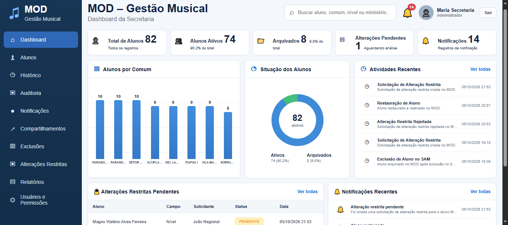
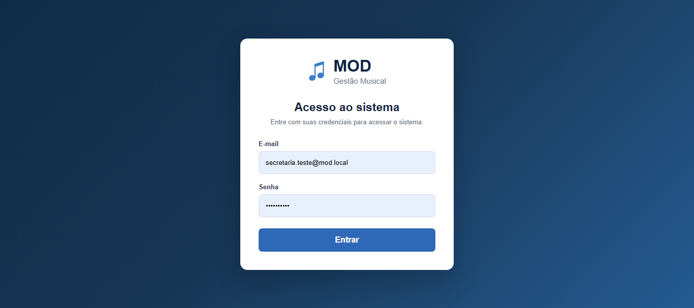
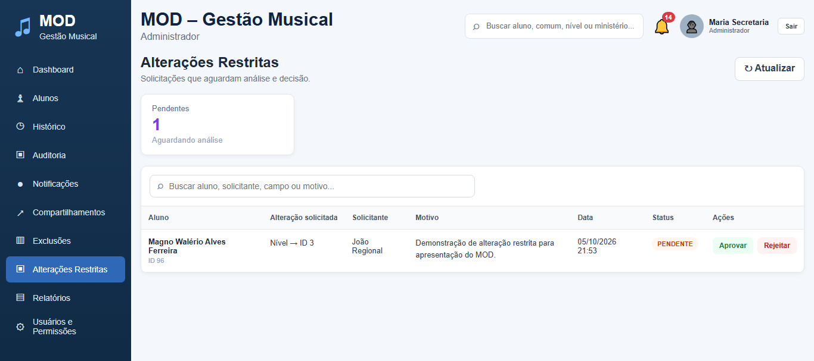
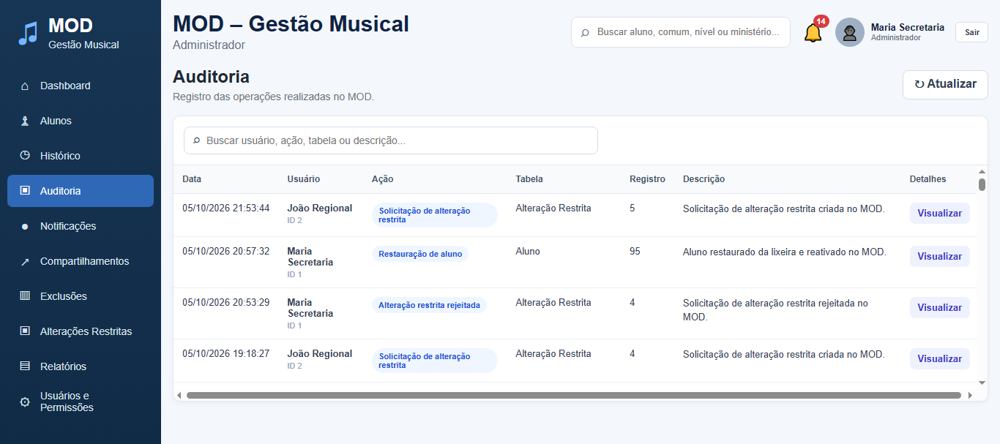
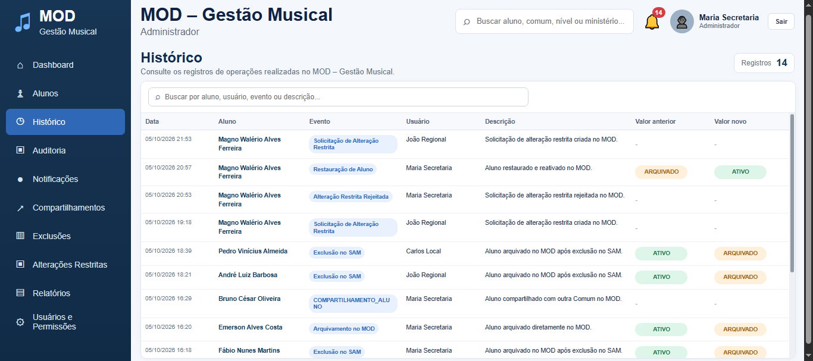
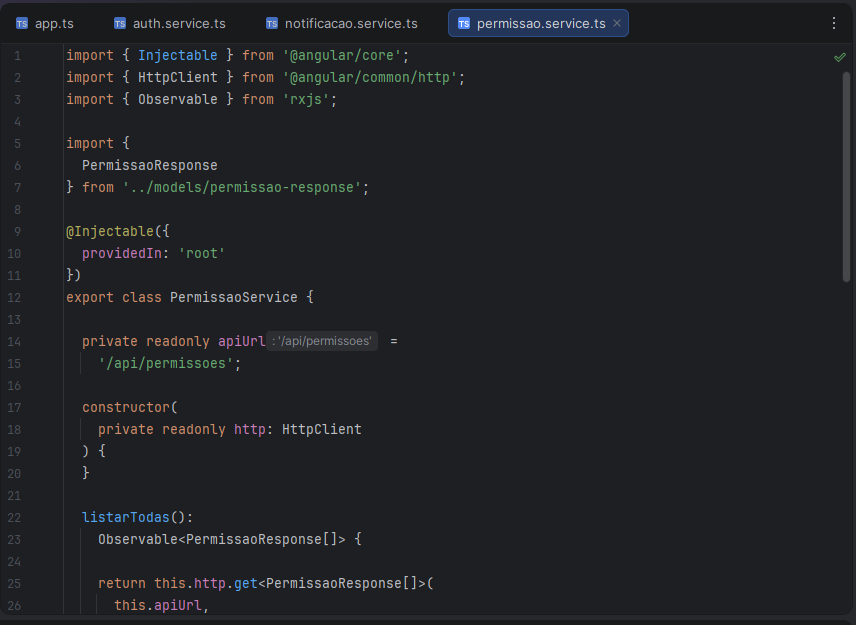

# MOD – Gestão Musical | Frontend

Interface web do **MOD – Gestão Musical**, sistema de apoio à gestão de alunos e aos processos administrativos de uma secretaria musical. Este repositório contém a aplicação frontend desenvolvida com **Angular 22 e TypeScript**, integrada a uma API REST construída em **Java 21 e Spring Boot**.

> **Status:** projeto em desenvolvimento. Algumas funcionalidades e integrações ainda estão em evolução.

## Sobre o projeto

O MOD busca centralizar informações e facilitar o acompanhamento de alunos, atividades administrativas e operações que exigem rastreabilidade e controle de acesso. O frontend disponibiliza uma interface para consulta e operação dos módulos do sistema, respeitando as permissões definidas no backend.

## Tecnologias

- Angular 22 (projeto gerado com Angular CLI 22.2.0)
- TypeScript
- HTML e CSS
- Integração com API REST em Java 21 / Spring Boot
- Git e GitHub para versionamento

O banco de dados **PostgreSQL** é utilizado pelo backend, não diretamente pelo frontend.

## Funcionalidades apresentadas na aplicação

- Autenticação e encerramento de sessão de usuário.
- Dashboard administrativo com indicadores e gráficos de alunos.
- Visualização e gerenciamento de informações de alunos.
- Consulta de histórico e registros de auditoria.
- Visualização de notificações e atividades recentes.
- Interface para solicitações e análise de alterações restritas, conforme as permissões do usuário.
- Navegação para módulos administrativos, incluindo arquivamento/exclusões e compartilhamentos.

> A disponibilidade efetiva de cada operação depende do perfil autenticado e dos endpoints implementados no backend. Módulos ainda em desenvolvimento não devem ser interpretados como concluídos.

## Arquitetura e integração

```text
Usuário
  |
  v
Frontend Angular + TypeScript (localhost:4200)
  |
  | HTTP / API REST
  v
Backend Java 21 + Spring Boot (localhost:8080)
  |
  v
PostgreSQL
```

As regras de negócio, autenticação, autorização e persistência são responsabilidades do backend. O frontend apresenta os dados e disponibiliza as ações permitidas para cada usuário.

## Como executar localmente

### Pré-requisitos

- Node.js e npm compatíveis com a versão do Angular utilizada no projeto.
- Backend do MOD configurado e em execução para utilizar funcionalidades que dependem da API.

### Instalação

```bash
git clone https://github.com/MagnoDevbraul/mod-gestao-musical-frontend.git
cd mod-gestao-musical-frontend
npm install
```

### Iniciar o servidor de desenvolvimento

```bash
npx ng serve
```

Acesse **http://localhost:4200/** no navegador.

> Verifique a configuração da URL da API e de CORS no backend para permitir a comunicação entre as aplicações. A porta 8080 é a utilizada no ambiente de desenvolvimento do MOD.

### Gerar uma versão de produção

```bash
npx ng build
```

Os arquivos gerados ficam no diretório `dist/`.

### Executar testes

```bash
npx ng test
```

Este comando executa a configuração de testes disponível no projeto; ele não implica, por si só, que haja uma suíte completa de testes implementada.

## Capturas de tela

As imagens abaixo foram capturadas diretamente da aplicação em execução, em ambiente de desenvolvimento.

### Dashboard administrativo



### Autenticação



### Alterações restritas



### Auditoria



### Histórico



> **Privacidade:** antes de publicar este material, confirme que os nomes, identificadores e registros exibidos são fictícios ou que sua divulgação foi autorizada. Caso contrário, substitua ou oculte esses dados nas capturas.

## Implementação técnica — Angular e TypeScript

### Serviço de permissões (`permissao.service.ts`)

A imagem abaixo apresenta um trecho real do serviço Angular responsável por consultar permissões na API REST do MOD.



Neste trecho, a implementação utiliza:

- **`@Injectable({ providedIn: 'root' })`** para disponibilizar o serviço por meio da injeção de dependências do Angular.
- **`HttpClient`** para realizar requisições HTTP ao endpoint `/api/permissoes`.
- **`Observable<PermissaoResponse[]>`** do RxJS para representar a resposta assíncrona da consulta.
- **`PermissaoResponse`** para tipar os dados retornados pela API.

O frontend consome os endpoints expostos pelo backend em Java e Spring Boot. A validação das permissões e as regras de autorização permanecem sob responsabilidade do servidor.

## Repositório do backend

[MOD – Gestão Musical | Backend Java e Spring Boot](https://github.com/MagnoDevbraul/mod-gestao-musical-backend)

## Próximas melhorias

- Evolução dos módulos administrativos ainda pendentes.
- Ampliação dos testes automatizados.
- Aprimoramento da documentação e das capturas de tela.
- Validação das integrações e dos fluxos completos entre frontend e backend.

## Contexto acadêmico

Projeto desenvolvido como aplicação prática de conhecimentos de **Análise e Desenvolvimento de Sistemas**, com foco em desenvolvimento Full Stack e especialização em **Back-end Java**.
